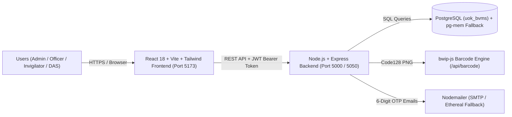
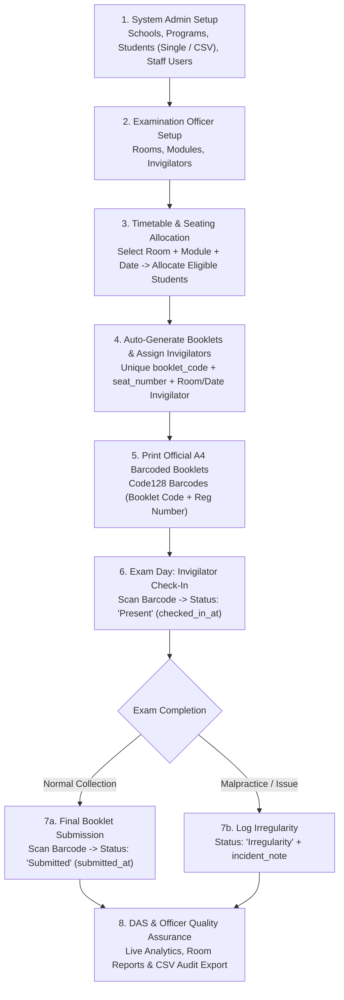
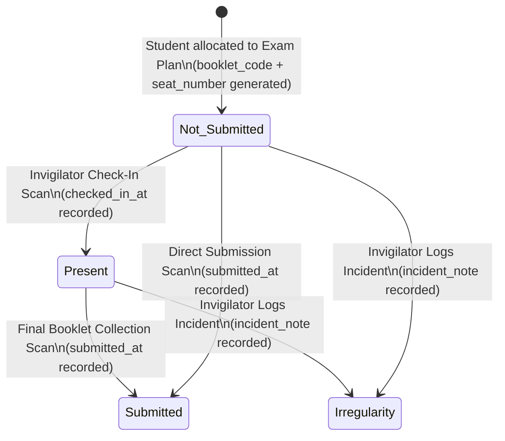
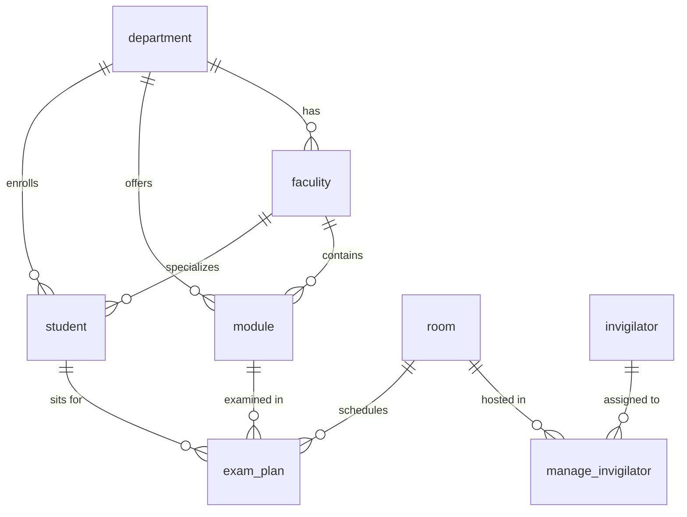

# University of Kigali (UoK) — BVMS Project Workflow

This document describes the complete operational, architectural, and technical workflow of the **Booklet Verification Management System (BVMS)** (`bvms-modern`).

---

## 1. High-Level System Architecture

- **Frontend (`frontend/`)**: React 18, React Router v6, Tailwind CSS, Axios (with JWT interceptors), `html5-qrcode` (live webcam barcode scanner), and printable A4 barcoded booklet templates.
- **Backend (`backend/`)**: Express REST API with JWT authentication (`12h` expiry), `bcryptjs` password hashing (with legacy SHA-1 verification fallback), `bwip-js` Code128 barcode generation, and `nodemailer` for password reset OTP emails.
- **Database (`backend/src/db/`)**: PostgreSQL (`uok_bvms`). On startup, `initDatabase()` automatically executes `schema.sql` and seeds initial UoK data if tables do not exist. If local PostgreSQL is unavailable, it seamlessly falls back to an in-memory `pg-mem` engine.

---

## 2. End-to-End Examination Workflow

---

## 3. Step-by-Step Workflow by Role

### Stage 0: Authentication & Account Security (All Roles)
1. **Sign In (`/login` → `POST /api/auth/login`)**:
   - Users log in with their official email (or role alias) and password.
   - Backend validates credentials, resolves `invigilator_id` if the user is an invigilator, and returns a signed **JWT token** valid for 12 hours.
   - `HomeRedirect` automatically routes the user to their role-specific dashboard (`/admin`, `/officer`, `/invigilator`, or `/das`).
2. **Password Recovery (`POST /api/auth/forgot-password` → `POST /api/auth/reset-password`)**:
   - Generates a **6-digit OTP** valid for 15 minutes and emails it via `services/mailer.js` (real SMTP if configured in `.env`, or Ethereal preview URL in dev).
   - Enforces strong password rules (min 8 chars, uppercase, lowercase, number, special character).
3. **Profile & Password Management (`/profile`)**:
   - Users can update contact details (`PUT /api/auth/profile`) and change passwords (`PUT /api/auth/change-password`), clearing `must_change_password` on first login.

---

### Stage 1: System Administrator (`admin`)
**Goal:** Establish the university's academic hierarchy, student registry, and staff accounts.

1. **Manage Schools / Departments (`/admin/departments`)**:
   - Create and maintain UoK Schools (e.g., `SCIT`, `SBM`, `SL`, `SE`).
2. **Manage Degree Programs / Faculties (`/admin/faculties`)**:
   - Register degree programs linked to a School (e.g., `BIT`, `BCS`, `BBA-FIN`, `LLB`).
3. **Manage Students (`/admin/students`)**:
   - Register students individually or via **Bulk CSV Import** (`POST /api/admin/students/bulk`), mapping each student to a School (`department`), Program (`options`), and Academic `year` (1–5).
4. **Manage System Users (`/admin/users`)**:
   - Create accounts for `admin`, `examination_officer`, `Invigilator`, and `DAS`.
   - Creating an `Invigilator` user automatically syncs a record in the `invigilator` table.

---

### Stage 2: Examination Officer (`examination_officer`)
**Goal:** Configure exam resources, build timetables, assign invigilators, and print barcoded answer booklets.

1. **Register Resources**:
   - **Invigilators (`/officer/invigilators`)**: Adding an invigilator automatically creates their login account (`user_type: 'Invigilator'`, default password `12345`, `must_change_password: TRUE`).
   - **Examination Rooms (`/officer/rooms`)**: Define room names and maximum student seating capacities (`numberofstudent`).
   - **Academic Modules (`/officer/modules`)**: Register modules linked to School, Program, and Year.
2. **Create Exam Timetable & Allocate Seating (`/officer/make-timetable`)**:
   - Officer selects a **Room**, **Module**, and **Exam Date**.
   - Backend (`GET /api/officer/eligible-students`) calculates remaining room capacity and returns students matching the module's `(department, faculty, year)` who are **not already scheduled** for another exam on that date.
   - Officer allocates selected/auto-filled students (`POST /api/officer/timetable`).
   - For each allocated student, the system automatically assigns:
     - Sequential `seat_number`
     - Unique `booklet_code` (`UOK-BK-YYYYMMDD-<room_id>-<seat>`)
     - Initial `exam_status = 'Not Submitted'`
3. **Assign Invigilators to Rooms (`/officer/assign-invigilators`)**:
   - Link an invigilator to a specific `room_id` and `exam_date` (`manage_invigilator` table).
4. **Generate & Batch-Print Barcoded Booklets (`/officer/view-timetable`)**:
   - Opens `BookletViewerModal` to render official printable **A4 UoK Examination Answer Booklets** featuring candidate metadata, seat number, grading box, sign-off block, and dual **Code128 barcodes** (`/api/barcode?value=...`) for both the Registration Number and Booklet Serial Code.

---

### Stage 3: Invigilator (`Invigilator`)
**Goal:** Conduct real-time, tamper-proof attendance and booklet collection in the exam room.

1. **View Assigned Schedule (`/invigilator` → `GET /api/invigilator/my-schedule`)**:
   - Displays only the exam rooms and dates assigned to the logged-in invigilator.
2. **Select Active Session**:
   - Invigilator chooses the date, room, and module to load the room's student roster.
3. **Two-Stage Live Verification (`POST /api/invigilator/verify`)**:
   - Invigilator scans the booklet's Code128 barcode via **live webcam** (`html5-qrcode`) or enters the **Registration Number / Booklet Code** manually.
   - **Mismatch Protection**: If a scanned student belongs to a different room, module, or date, the API rejects the scan and reports the student's actual assigned room/module/date.
   - **Stage A — Check-In (`Present`)**: Marks the student as `Present` and records `checked_in_at` when the booklet is issued.
   - **Stage B — Final Collection (`Submitted`)**: Marks the booklet as `Submitted` and records `submitted_at` when the student hands in their script.
   - **Exception — Irregularity (`Irregularity`)**: Flags the sitting with an `incident_note` if exam malpractice or a booklet issue occurs.

---

### Stage 4: Director of Academic Services (`DAS`)
**Goal:** Executive oversight, quality assurance, and audit reporting.

1. **Executive Dashboard (`/das` → `GET /api/admin/stats`)**:
   - Monitors university-wide KPIs: total students, rooms, modules, allocated booklets, `Present` check-ins, and `Submitted` completion rates.
2. **Read-Only Directory Oversight**:
   - Reviews Schools & Programs (`/das/schools`), Students (`/das/students`), and Invigilators (`/das/invigilators`).
3. **Verification Reports & CSV Export (`/das/reports` & `/officer/reports`)**:
   - Filters exam plans by date, room, or module (`GET /api/officer/exam-plans`) and exports full verification audit trails to CSV.

---

## 4. Booklet Verification Lifecycle (State Machine)

---

## 5. Database Schema Relationships

| Table | Purpose |
| :--- | :--- |
| `users` | Staff authentication accounts (`admin`, `examination_officer`, `Invigilator`, `DAS`) |
| `department` | UoK Schools / Departments |
| `faculity` | Degree Programs / Options linked to a School |
| `student` | Student records with unique `reg_number` and academic placement |
| `room` | Examination rooms and seating capacities |
| `module` | Academic courses linked to School, Program, and Year |
| `invigilator` | Invigilator directory synced with `users` |
| `manage_invigilator` | Maps invigilators to rooms on specific exam dates |
| `exam_plan` | Core seating allocation, unique `booklet_code`, status, timestamps, and incident notes |

---

## 6. Key API Endpoints Summary

| Group | Base Path | Key Endpoints |
| :--- | :--- | :--- |
| **Health** | `/api/health` | `GET /api/health` |
| **Auth** | `/api/auth` | `POST /login`, `POST /forgot-password`, `POST /reset-password`, `GET /me`, `PUT /profile`, `PUT /change-password` |
| **Admin** | `/api/admin` | `GET /stats`, CRUD `/users`, `/departments`, `/faculties`, `/students`, `POST /students/bulk` |
| **Officer** | `/api/officer` | CRUD `/invigilators`, `/rooms`, `/modules`, `/invigilator-assignments`, `GET /eligible-students`, `POST /timetable`, `GET /exam-plans`, `DELETE /exam-plans/:id` |
| **Invigilator** | `/api/invigilator` | `GET /my-schedule`, `POST /verify` |
| **Barcode** | `/api/barcode` | `GET /api/barcode?value=...` (Public Code128 PNG generator) |

---

## 7. Running the Project Locally

- **One-Click Windows Launch**: Double-click `start-uok-bvms.bat` in the project root to start both backend and frontend servers in separate terminals.
- **Manual Launch**:
  1. Backend: `cd backend && npm install && npm start` (runs on port defined in `.env`, default `5000`/`5050`)
  2. Frontend: `cd frontend && npm install && npm run dev` (runs on `http://localhost:5173`)
